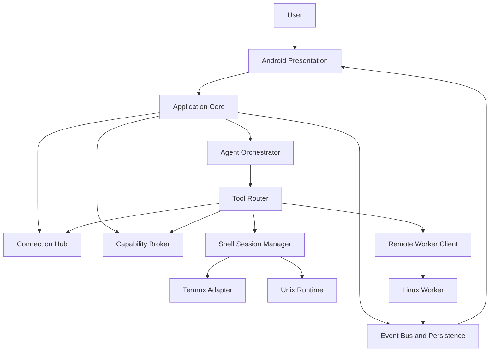

# Quorvi Launcher

## Product, experience and architecture specification

**Type:** a high-end Android launcher with autonomous agents, a Unix terminal, connections and device control.
**Platforms:** Android across vendors; Linux for remote workers.
**Initial use:** private, installed from an APK. Google Play is not assumed.
**Assistant:** the AI inside the launcher is called **Nexo**.

> **The idea in one sentence:** turn Android into a personal operations environment where the launcher is exceptionally polished and customizable, the AI carries out real work on its own, and connections, processes and devices can be watched and controlled from one interface.

**This document describes the target product. It does not claim that every capability already exists.** It separates requirements, design proposals, verified constraints and pending experiments. Anything that depends on the ROM, API level, vendor or privileges has to be detected at runtime and degrade gracefully.

**Priority order:** (1) launcher reliability and safety, (2) usability and performance, (3) task engine and terminal, (4) observability, (5) connections, (6) privileged capabilities, (7) advanced visual experiments. Complexity is added in layers without blocking the basics.

**Engineering rules:**

- Don't invent APIs or assume Android allows something because root or Shizuku exists. Read the docs and prototype.
- Don't add a dependency without checking maintenance, version, license and compatibility with the chosen target SDK.
- A test only counts as passed if it ran. Missing hardware or tools means `NOT VERIFIED` plus the procedure to validate it.
- Don't copy private scripts, keys or folders from other projects without reviewing their license, security and dependencies.
- Every delivery comes with code, relevant tests, traces or benchmarks where they matter, docs, and an exact account of what works and what doesn't.
- Risky operations stay behind feature flags and recovery paths. Root is never required to start the launcher.

# 1. Settled decisions

| Area | Decision |
|---|---|
| Scope | Launcher + agent platform + operations center; not a full Android replacement |
| Compatibility | Works across brands and ROMs; Ulefone is the main test device, not the only target |
| Distribution | Privately installable APK; the Play Store does not drive early decisions |
| Privileges | Optional levels: standard, special permissions/accessibility, ADB/Shizuku, granular root and experimental modules |
| Firmware | No required changes to `/system`, `boot`, vendor or SystemUI; optional, reversible modules only |
| Visual experience | High end, distinctive, expressive and fluid; deep customization and performance modes |
| UX | Original while keeping the patterns that make it easy to learn; not Niagara-style minimalism |
| Surfaces | Canvas, Command, Operations, Control Studio and Studio |
| Agents | Long goals, planning, subtasks, memory, tools, verification, shell and screen use |
| Autonomy | Manual, automatic and bypass, with configurable limits and a full audit trail |
| Shell | Two selectable environments: an installed Termux and Quorvi's own Unix runtime, visually integrated |
| Execution | Hybrid: local Android plus remote Linux workers, chosen automatically or by hand |
| First connections | GitHub, Docker, Home Assistant, SSH/Linux, Google Drive, Android devices, HTTP services, Discord and GitLab |
| Operations | GitHub Actions-style tracking: runs, jobs, steps, DAG, logs, terminal, timing, cost, artifacts and retries |
| Agent status | Configurable indicators (cards, compact island, notifications, Operations) |

## 1.1. Non-negotiables

1. **The launcher works without AI:** opening apps, widgets, folders, gestures and local settings works offline, with no account and no model configured.
2. **The UI never blocks:** no LLM, shell, connector or heavy worker runs on the main thread.
3. **Observable autonomy:** every agent action has an identity, a reason, an input, a result and a traceable origin.
4. **Capabilities are detected, not assumed:** never show an operation as available when the device or service can't do it.
5. **Opt-in escalation:** the user decides which capabilities to grant; root is never assumed.
6. **Predictable behavior:** deep customization without unexpectedly shuffling what the user pinned.
7. **Recovery:** a failing connector, experimental view or privileged service never leaves the user without a usable home screen.
8. **No fake signals:** never invent progress, network state, percentages, metrics, costs or passing tests.

## 1.2. Out of scope for the first usable product

- A universal, complete replacement for SystemUI or the lock screen.
- Recents/Quickstep integration identical to any vendor launcher.
- Visually driving any background app while the user freely uses the same screen.
- An embedded shell automatically compatible with every Termux package without rebuilds.
- Perpetual local execution that survives force-stop, power-off, OEM restrictions and an empty battery.
- A marketplace of untrusted extensions and scripts with unlimited privileges inside the UI process.

These are not permanent bans; they are future capabilities or separate experiments.

# 2. Experience: five spaces, one interface

## 2.1. Canvas: the home screen

Canvas replaces Android's usual home screen but keeps its essentials. It should feel familiar within minutes and allow much deeper customization over time.

**Blocks:** apps, shortcuts, folders, Android widgets, connection components, agent status cards, reusable actions, device indicators, search, a compact terminal, metric views, controls and optional free text.

**Layout:** configurable pages and workspaces; a flexible grid plus fine positioning; alignment rules, snap-to-grid, anchors and safe margins; orientation and size support; locked items; visual layers; responsive on tablets and foldables where it makes sense.

**Behavior:**

- Configurable dock, folders, optional badges, labels, icon packs, per-app icons, sizes and backgrounds.
- A complete app drawer with instant search, favorites, optional categories and hidden apps.
- Real Android widgets through `AppWidgetHost`, with configuration and binding handled correctly.
- Widgets and Quorvi cards side by side, with persistent state, placeholders and refresh policies.
- A gesture to open Command, quick access to Operations, a path into Control Studio and user-defined modes.
- Pinned positions are respected: predictive suggestions never reorder the home screen on their own.
- Keyboard, accessibility, locale and profile visibility limits are supported.

**Differentiator:** a compact component can expand through a continuous transition into a full view (for example a GitHub Actions card into the workflow detail) while keeping context and state.

## 2.2. Command: the universal bar

Command is the entry point to find and act, not just a chat.

**Implicit modes:** (a) open, (b) find, (c) run an action, (d) start an agent, (e) check status. Detection uses a low-latency pipeline: local index and rules first, an LLM only when it adds value.

Examples:

- `gh actions kernel` → relevant repositories/workflows and supported actions.
- `ssh server` → a terminal session or connection status.
- `make a report on photosynthesis and put it in Downloads` → a new background run.
- `check why this build failed` → a contextual run linked to the selected workflow.
- `focus mode` → the configured actions that are available.
- `yesterday's screenshots` → local search over what Quorvi can access.

**UX rules:** opening Command never waits for an LLM; app results show instantly from cache; potentially dangerous actions show their scope and context; the query can be edited without losing the previous context; private data is not sent to a remote provider without the matching policy.

## 2.3. Operations: the activity center

Operations mixes GitHub Actions, a process manager, a session manager and an observability panel. Its core entities are `Run`, `Task`, `Step`, `ToolCall`, `Process`, `Session`, `Artifact` and `Event`.

**List view:** active, queued, waiting for input, completed, failed, paused, cancelled; grouping by project/device/connection; filters; tags; search; favorites.

**Run view:**

- The original goal, state and owner (user, automation or agent).
- A DAG of subtasks: active, blocked by a dependency, succeeded, failed and skipped.
- A timeline with real timestamps, duration, model and executor.
- Structured logs and terminal output with scrolling, filtering and search.
- Screen captures/observations when relevant and authorized.
- Generated files with preview, checksum and export actions.
- Estimated or confirmed cost/compute/tokens, with their source.
- Pause new actions, cancel, retry an idempotent step, continue, adjust instructions, switch executor when safe.
- Which authorizations and privileged controls were used.

**Progress must be verifiable:** `3/5 steps done` is fine; a `67%` made up by the model is not. An ETA only appears with enough history behind it and is labeled as an estimate.

## 2.4. Control Studio: notifications, controls and media

A configurable panel with brightness, network shortcuts, Bluetooth, volume, the media player, devices and connectors, authorized notifications and agent status.

**Normally** it works as its own screen/panel and, with the overlay permission, as a surface over regular apps within Android's limits. Toggles that can't be guaranteed open the official panel or explain why. Notifications go through `NotificationListenerService` with specific consent. Media goes through authorized APIs such as `MediaSessionManager`.

**Intentional limit:** `TYPE_APPLICATION_OVERLAY` is drawn below critical windows (status bar, IME and others) and does not fully replace the system notification shade, Quick Settings or lock screen. Deep SystemUI integration is an optional, ROM-specific extension with recovery.

## 2.5. Studio: full customization

Two editing layers:

- **Visual:** move, resize, group, align, lock, theme and assign gestures/actions. Live preview, undo/redo, history and restore.
- **Advanced:** a versioned declarative format to import/export scenes, styles, animations, panels and command mappings. Validated schema, migrations and a safe mode when an import fails.

Grid/pages, dock, iconography, typography, radii, transparency, shadows, blur, backgrounds, effects, navigation, gestures, contextual items, the Operations and Control Studio layouts, agent indicators, rules and connection components can all be changed.

**Constraint:** an arbitrary layout never runs native code inside the UI process. Custom components use a declarative DSL/manifest and actions routed through the broker.

# 3. Visual design, motion and ergonomics

## 3.1. Visual direction

An original look with the clarity of a productivity tool, the expressiveness of cinematic animation and the organization of a powerful desktop. Avoid both extreme minimalism and futuristic clutter. Complex information appears on expansion; it isn't forced onto the home screen.

**Principles:** strong visual hierarchy; generous touch targets; material surfaces with depth; legible type; responsive brightness/color; coherent icons; animation with a visible cause; content always in front of effects.

**Configurable tokens:** `surface`, `surfaceElevated`, `scrim`, `accent`, `accentMuted`, `textPrimary`, `textSecondary`, `spacingScale`, `cornerScale`, `blurRadius`, `shadowElevation`, `translucency`, `density`, `motionScale`, `springStiffness`, `springDamping`, `hapticProfile`.

**Accessibility:** contrast on essential text, scalable fonts, TalkBack/semantics, reduce-motion support, touch targets in line with Android guidelines, nothing conveyed by color alone.

## 3.2. Motion engine

- Shared geometry and content transitions: a card can expand into a detail view and return to the same element.
- Interruptible, interactive gestures: the animation follows the finger's speed and position and can be reversed before it ends.
- Physical springs with limits, consistent damping and no gratuitous bounces.
- Focus, scroll and selection continuity when a surface expands or collapses.
- Blur, transparency, parallax, depth and background blur, all configurable and degradable.
- Haptics tied to semantic events, not to every frame.
- Telemetry cards don't animate continuously; recompositions and off-screen updates are kept to a minimum.
- Honest loading/waiting animations, considered empty states and error transitions.

**Profiles:** `Instant` (minimal effects), `Balanced`, `Cinematic` (preferred) and `Custom` per parameter, configurable per component and globally, with an automatic power-saving mode.

## 3.3. Measurable goals (hypotheses, not guarantees)

- Stable 60 FPS on capable hardware, 90/120 FPS depending on the panel, load and render budget.
- An initial jank target under 1% on the main journeys of the reference device, measured and tuned per profile.
- Visual response to core interactions in about 100 ms or less at the agreed test percentiles.
- Opening the drawer, switching pages and using the dock never wait on the network, the shell or inference.
- Frame time, p50/p95/p99 interaction latency, memory, CPU, battery and regressions are recorded.

A 120 Hz frame is about 8.33 ms. 120 FPS is not promised on every ROM or device. Macrobenchmark, JankStats, Perfetto, Baseline Profiles and physical devices are the tools.

## 3.4. Navigation and ergonomics

- One configurable main gesture for Command and another for Operations; conflicts with the back gesture and vendor navigation are resolved.
- Important actions reachable with one hand and with a keyboard.
- Agent information doesn't take over the screen unless asked for or something relevant happens.
- Cards show a compact state; expanding is optional. Any component can be hidden.
- Preferences per device, orientation, workspace and visual profile.
- Backend failures never show up as a frozen home screen.

# 4. Android architecture and modules

## 4.1. Processes and responsibilities

**UI / Home process:** `HOME`, Canvas, navigation, widgets, scenes and animations. Kept minimal and resilient. It doesn't run blocking commands or hold unnecessary sockets.

**Core process / task service:** state, events, connections and the local agent. It can live in its own Android process for fault isolation, talking over Binder/AIDL.

**Accessibility service:** a special service enabled by hand and supervised by a `ScreenControlBroker`; third-party modules never get unrestricted control.

**Runtime:** a dedicated process for the Unix terminal and its storage, inside the same app.

**Privileged bridge (optional):** Shizuku, ADB or root services, tightly scoped and authenticated, with dynamic detection of UID and privileges. No privileged code in the UI process.

**Remote worker:** an independent Linux daemon whose life cycle doesn't depend on Android.

**Rule:** modules talk through stable contracts. The UI observes `Flow<State>` and sends commands; it holds no references to processes or network plugin implementations.

## 4.2. Launcher basics: hard requirements

- Register correctly for `ACTION_MAIN` / `CATEGORY_HOME`; request `ROLE_HOME` where available.
- App discovery and launch through `LauncherApps`, `PackageManager` and the right APIs, handling package visibility.
- Per-profile apps; work profiles; Private Space from Android 15 according to the launcher's role/permission.
- Static, dynamic and pinned shortcuts where they apply.
- A complete widget host (`AppWidgetHost`): bind, configure, host view, resize, update, rebind and errors.
- Grid, dock, folders, pages, hidden apps, reordering, icon packs, launch intents, uninstall/info.
- Robust handling of package changes, profile changes, reinstalls and restores.
- Static wallpapers and live wallpapers where supported; insets, bars, orientation and edge-to-edge.
- An efficient app drawer (lazy loading / cache) and a local search index.
- Home restores after a crash; access to an alternative launcher and to Settings is kept.
- Accessibility, languages, external keyboards, font size and landscape.

**Note:** Recents/Quickstep and some system gestures belong to privileged/OEM components. The experience isn't designed around replacing them without a ROM prototype.

## 4.3. Logical architecture



The diagram is conceptual: RPC, local state, network events and callbacks are distinct, and an arrow never means shared memory across UIDs.

## 4.4. Architecture patterns

- `feature-first` on Android; `core` modules stay small.
- Unidirectional state flow for screens; local storage is the source of truth for runs, settings and memory.
- `StateFlow`/`Flow` for internal streams, Room for persistence; versioned IPC between processes.
- Idempotent requests where possible, with deduplication and correlation keys.
- Feature flags for work in progress, the SystemUI panel, root and devices.
- Every tool backend returns a typed result: `SUCCESS`, `UNSUPPORTED`, `UNAUTHORIZED`, `TIMED_OUT`, `FAILED`, `CANCELLED` or `INTERRUPTED`.

# 5. Shell manager: a terminal for users and agents

## 5.1. Functional requirements

A terminal isn't a text field with the occasional process. Quorvi needs real session infrastructure, with persistent IDs, multiple processes, PTYs where needed and both human and automated access.

- Create an interactive terminal; open it as a panel, tab or expandable surface.
- Run non-interactive commands capturing `stdout`, `stderr`, exit code, cwd and duration.
- `spawn`, `attach`, `writeInput`, `resizePty`, `signal`, `terminate`.
- Streaming with ANSI sequences, bounded scrollback, encoding/Unicode and backpressure.
- Shell profiles, cwd, env and per-job variables.
- Command history and bookmarks; secrets are never stored in plain text in history.
- Bounded logs and output: explicit truncation spooled to disk with artifact references, never silent cuts.
- Human actions on a running session: follow, take over when safe, stop, copy, export.
- An agent can work in a shell without stealing focus; its output is visible from Operations.

## 5.2. Backend A: an installed Termux

A first realistic implementation: a `RUN_COMMAND` adapter running in the Termux app's context. It needs `com.termux.permission.RUN_COMMAND`, `allow-external-apps=true`, package visibility and consent. It returns results where supported; it doesn't assume full PTY/interactive session control through the intent.

**Required discovery:** compatibility per Termux version, session mode, intents, callbacks, permission scope, how long a process can persist and result size limits.

**File access:** the Termux shell runs with Termux's UID and permissions. Quorvi never reads `/data/data/com.termux` directly as if both packages shared a UID; it uses IPC, SAF, explicit exchange or its own bridge.

## 5.3. Backend B: Quorvi's Unix runtime

An embedded terminal with its own runtime. Termux packages embed `com.termux` paths and Android restricts running binaries from writable data areas, so this is built on a feasibility spike, not on copying an existing `$PREFIX`.

**Options compared:**

1. A runtime with a prefix and packages rebuilt or relocated for its package name.
2. Binaries installed in an executable location compatible with the target API, without relying on an exception that isn't guaranteed.
3. A remote isolated environment when local execution isn't viable for certain tools.
4. The Termux adapter as a fallback.

**Not allowed:** lowering the main launcher's target SDK across the board to enable an unsafe shortcut without weighing the consequences and its lifetime.

**Termux reuse:** review the GPLv3 license of the main repository and the licenses/exceptions of `terminal-view` and `terminal-emulator`, and keep an attributions file before distributing derivatives, even privately.

## 5.4. Session model

```text
ShellBackend = TERMUX_EXISTING | QUORVI_RUNTIME | SSH_REMOTE | WORKER_CONTAINER | ADB_SHELL | ROOT_SHELL
ShellSession(id, backend, ownerRunId?, ownerUserId?, profileId,
             deviceId, cwd, envRefs, pty, createdAt, lastSeenAt,
             state, processGroupRef, transcriptRef, limits)
CommandExecution(id, sessionId?, argv, cwd, envRefs, timeout,
                 stdinRef?, stdoutRef, stderrRef, exitCode?, state)
```

Secrets are never serialized into `envRefs`; they reference vault entries. Sensitive arguments aren't logged. Typed `argv[]` is preferred when a shell isn't needed; shell strings only when that semantics is asked for.

## 5.5. File export and `Downloads`

The agent writes to its own workspace first. Format, integrity and size are checked; then the file is exported through `MediaStore.Downloads` or SAF, respecting permissions, scopes and Android versions. Exporting a document the app created never requires full storage access.

`Artifact(id, sourceRun, mime, size, sha256, localUri, exportedUri?, createdAt, provenance, verified)` is recorded. Final names resolve collisions; existing files are never overwritten without an explicit policy.

# 6. Agent engine: from instructions to results

## 6.1. How it works

The AI is not the operating system. The model proposes plans and typed calls; the `Tool Router` and the `Policy Engine` check and dispatch actions. System results are the source of truth, not an LLM saying "done".

**Pipeline:**

1. Receive the instruction and authorized context.
2. Classify the goal, sensitivity, likely tools and executors.
3. Create a persistent run with its budget, policy and goal.
4. Plan tasks and dependencies against real capabilities.
5. Run steps and tool calls with concurrency control, timeouts and cancellation.
6. Observe results; update events, logs, artifacts and memory.
7. Verify deliverables with deterministic checks where they exist.
8. Complete, report, ask for help or fail explicitly; never fake success.

## 6.2. State model

```text
RunState = QUEUED | PLANNING | RUNNING | WAITING_CAPABILITY |
           WAITING_USER | PAUSING | PAUSED | RETRYING | VERIFYING |
           COMPLETED | FAILED | CANCELLED | INTERRUPTED
StepState = PENDING | READY | RUNNING | SUCCEEDED | SKIPPED |
            BLOCKED | FAILED | CANCELLED | INTERRUPTED
```

Transitions go through a state machine. Events are append-only with incremental snapshots, protected against duplicates and out-of-order updates. Disconnected executors use correlated IDs and per-run sequences.

**DAG:** independent subtasks can run in parallel; explicit dependencies keep a step from starting before its inputs exist. Fan-out is bounded by process/model/network limits. Fan-in checks results before continuing.

## 6.3. First tools

| Namespace | Base operations | Notes |
|---|---|---|
| `shell` | `exec`, `spawn`, `attach`, `signal`, `list` | Separate backends and permissions |
| `fs` | `list`, `read`, `write`, `stat`, `search`, `export` | Workspace/SAF; no arbitrary paths outside scopes |
| `web` | `search`, `fetch`, `open` | Untrusted external data; provenance kept |
| `android` | `listApps`, `launch`, `inspectUi`, `screenshot`, `act`, `readNotifications` | Needs the matching capabilities |
| `connections` | `query`, `subscribe`, `execute` | Connector contracts and scopes |
| `task` | `spawn`, `status`, `pause`, `cancel`, `artifact` | Bounded subtasks |
| `memory` | `search`, `propose`, `save`, `forget` | Scopes, confidence, review |
| `remote` | `selectWorker`, `run`, `transfer` | Encrypted connections and consent |

Each tool has a `name`, `version`, JSON Schema for its arguments, required capabilities, risk, estimated cost and idempotency semantics. Raw `su` is never exposed as an all-powerful function by default.

## 6.4. Verifying results

Three separate things: `model_output`, `execution_result` and `verified_artifact`.

- File: exists, expected size, consistent MIME type, opens/renders where relevant; SHA-256.
- Script: exit code and its tests; if tests didn't run, that limitation is recorded.
- Research: sources, dates, quotes and a clear line between facts and inferences.
- Android operation: read the resulting state or observe it; never assume a tap worked.
- External service: check the API response and the final state where possible.

An agent never reports `COMPLETED` just for producing text or launching a command that is still running.

## 6.5. Recovery, checkpoints, idempotency

- The plan and its dependencies are persisted before destructive or long actions.
- `attempt`, `executorId`, `startedAt`, `heartbeatAt`, `lastCommittedStep` and `checkpointRef` are recorded.
- On reconnect, ask whether the remote action already ran before retrying.
- Non-idempotent operations (sending a message, deleting files, restarting a container) need specific deduplication or a fresh confirmation.
- Cancellation: mark `CANCELLING`, stop new tool calls and signal compatible processes. Rollback of effects that already happened is not promised.
- Retries with backoff and per-cause limits; errors are classified as permanent, transient or permission-related.
- When the agent lacks a capability or context, it moves to `WAITING_USER` with a concrete question.

## 6.6. Model planner

An extensible provider interface: several models, compatible endpoints, routes, quotas and costs. Tool calls, text, vision and streaming where they apply. No dependence on fixed model names or a single provider.

**Default policy:** rules/local index to open apps; a light model to classify and pick tools; a strong model to plan and code; a multimodal model for the screen; deterministic verifiers first. Success rate, tokens, latency, cost, timeouts and format errors are measured.

**Credentials:** per-provider API keys live in a vault; the agent gets a `providerProfileId`, never the token.

# 7. Memory and context

## 7.1. Kinds of memory

| Kind | Scope | Example |
|---|---|---|
| Preferences | User / workspace | Prefer not to be interrupted during recoverable tasks |
| Episodic | Run / project | A build failed; fix verified in a given run |
| Procedural | Tool / project | Proven steps to generate and validate a PDF |
| Projects | Workspace / device | Repository paths, build commands, services |
| Contextual | Session / goal | Current screen, quoted files and selection |
| External facts | Source / access | Data from an API or the web, with a timestamp |

## 7.2. Memory policy

- SQLite/Room as the structured base; FTS first; embeddings/vector search only if they measurably improve recall.
- Every entry records `source`, `scope`, `createdAt`, `expiresAt?`, `confidence`, `sensitivity`, `verificationState`.
- Observed facts, explicit preferences, hypotheses and LLM summaries are kept apart.
- Isolation between Android profiles, accounts, repositories and agents by scope.
- A UI to view, edit, pin, export and delete memories.
- Configurable retention for transcripts, captures, logs, snapshots and artifacts.
- The AI never saves passwords, tokens, OTPs or credentials it comes across.
- Old procedures are checked against current tool versions and invariants before reuse.

## 7.3. Context retrieval

Order: the request itself → the selected task's references → local project data → tool results → relevant memories → the model's general knowledge. Provenance goes into structured prompts. The full history isn't dragged into every call.

# 8. Autonomy, consent and action safety

## 8.1. Modes

| Mode | Behavior | Limit |
|---|---|---|
| `MANUAL` | Plan and operations are reviewed and approved | Nothing unapproved runs |
| `AUTO` | Runs pre-authorized capabilities; escalates when needed | Denies what exceeds its profile |
| `BYPASS` | Maximum configured autonomy, fewer repeated prompts | Not full access by default, never bypasses OS controls |

Configuration is multi-dimensional, not a single power switch.

## 8.2. Policy engine dimensions

- Subjects: user, agent, run, process, device, connector, account and worker.
- Resources: workspace, folder, repository, endpoint, device, UI, Android profile.
- Actions: read, write, delete, execute, network, publish, change settings, use root, control the screen.
- Conditions: time, network, Wi-Fi, battery level, free screen, prior confirmation, cost limit, frequency.
- Decisions: `ALLOW`, `DENY`, `REQUIRE_CONFIRMATION`, `WAIT_FOR_CONTEXT`, with a readable, audited reason.
- Separate root permissions (read, control, privileged shell, persistent changes, experimental).
- New actions can be revoked immediately; a process that already started and can't be reverted is reported as such.

**Example:** allow running scripts and writing inside a development container without asking; require specific permission to delete `/home`, push, restart Docker or touch the phone's partitions.

## 8.3. Threat model in short

Attacks considered: prompt injection from web pages, logs or READMEs; token exfiltration; shell injection through argument concatenation; extensions feeding false data; Docker socket abuse; SSRF into the local network; accessibility manipulation; spoofed remote services; malicious dependencies; spying through logs; sync and idempotency bugs.

Minimum mitigations: credentials kept out of prompts, per-connector restrictions, typed commands, output/path validation, configurable allowlists, real sandboxing where possible, mutual authentication, resource limits, protected local logs, secret scrubbing and per-operation permission review. A policy enforced inside the same UID as an arbitrary shell **is not a security sandbox**.

## 8.4. A busy screen and a user using it

A `Screen Arbitration Manager` reserves visual interaction only when a session is granted. Active human interaction pauses new agent gestures. In automatic mode the agent prefers shell/API and waits before conflicting visual actions; there is no hidden second virtual screen where everything just works.

**Kill switch:** always visible, it stops new actions and asks compatible processes to cancel. It works even when the LLM is stuck.

# 9. Connection hub and nine first integrations

## 9.1. Common connector model

A connector is more than an API client. It includes:

1. **Resources:** what it can query (repository, workflow, container, device, sensor, file, allowed message).
2. **Queries:** read views with pagination, filters, rate limiting and caching.
3. **Actions:** intentional typed operations (rerun, open a shell, trigger a scene…).
4. **Subscriptions:** real-time events over WebSocket/webhooks or throttled polling.
5. **Widgets:** declarative components and adaptive layouts.
6. **Tools:** actions offered to agents through the broker.
7. **Permissions:** OAuth scopes, tokens, credentials and per-operation capability.
8. **Health:** authentication, latency, API availability, stale data, rate limits and errors.

**Principles:** icons and panels render from shared data models without erasing provider specifics; provider logic isn't duplicated across UI, agent and worker. Tokens live in a secure store or on the authenticated worker, wherever the work runs.

## 9.2. Suggested Kotlin contract

```kotlin
interface QuorviConnector {
    val manifest: ConnectorManifest
    suspend fun connect(request: ConnectionRequest): ConnectionResult
    suspend fun healthCheck(accountId: String): HealthResult
    suspend fun query(request: ConnectorQuery): ConnectorResult
    suspend fun execute(request: ConnectorAction): ActionResult
    fun events(subscription: ConnectorSubscription): Flow<ConnectorEvent>
}

data class ConnectorManifest(
    val id: String,
    val version: Int,
    val capabilities: Set<String>,
    val authKinds: Set<String>,
    val actions: List<ToolDescriptor>,
    val widgetDescriptors: List<WidgetDescriptor>
)
```

The contract supports semantic versioning, structured errors, JSON Schema parameters and artifact references; it doesn't assume every provider streams.

## 9.3. Per-connector notes

### GitHub

**MVP:** connect the account securely; list selected repositories; PR/issue status; latest GitHub Actions runs; jobs, steps, logs and artifacts; open the original URL; live run tracking with adaptive polling. `workflow_dispatch` and reruns only with the right scopes and confirmations per policy.

**Panels:** `Repo Health`, `Recent Workflows`, `Failing Jobs`, `Pending PR Reviews`, `Release Progress`.

**Agent:** given a failed run, fetch what matters, analyze the error and work in a local/remote workspace without touching the repository by default. Branches, PRs and pushes only with explicit permission.

### GitLab

**MVP:** projects, pipelines, jobs, merge requests, logs and artifacts; filters by branch/state; retry/cancel/trigger when the token allows.

**Unification:** `CIExecution` as an entity shared with GitHub, with `providerSpecific` for each platform's own states.

### Docker

**MVP:** host profiles over SSH/TLS; containers, state, uptime, resources, logs and start/stop/restart on authorized hosts; optional Docker Compose.

**Safety:** daemon or socket access counts as administrative access to the host. Docker Engine is never exposed over TCP without TLS authentication, and a root socket never lives in the Android UI process.

### SSH / Linux

**MVP:** several hosts, secure authentication, a PTY terminal, command execution, file transfer, connectivity state, processes/metrics, systemd services where present. Host key verification is kept; fingerprint changes are never accepted silently.

**UI:** a small host health card, process details, folder shortcuts and sessions that can be pinned to the home screen. Telemetry sampled at a configurable rate.

### Home Assistant

**MVP:** instance URL; a secure token; devices, entities, states, sensors, lights and scenes; change events over WebSocket where it fits; actions on authorized entities.

**UI:** direct touch control of devices, rooms and scenes; a clear stale state when the link drops.

### Google Drive

**MVP:** OAuth/file picker, search, listing, opening, download/export and controlled upload to allowed places. Start with the smallest scope (for example `drive.file` where it's enough). Changes always depend on scopes and the agent mode.

**Agent:** the tool receives authorized objects/IDs; account permissions aren't used to walk all of Drive when the task needs one file.

### Discord

**MVP:** identity and allowed integrations through OAuth2/bots as appropriate; the servers/channels and events the integration can access; panels limited by permissions and intents.

**Constraint:** no self-bots and no automating a personal account with client tokens. Anything the official API doesn't allow is marked unsupported.

### Android devices

**MVP:** pairing with another Quorvi install; name, version, battery, connectivity, capabilities, presence and authorized runs. Each remote Android applies its own policy engine and can refuse actions.

**Does not mean:** ADB open to the network or an unauthenticated root service. The channel is authenticated and pairing is revocable.

### Custom HTTP services

**MVP:** a visual API editor: base URL, method, headers, authentication, body, JSONPath/JMESPath or an equivalent selector, refresh rate, output schema and actions. Request/response preview with secrets redacted.

**Widgets:** text, counter, traffic light, time series, button, toggle and list, with reactive data binding and error handling.

**Safety:** per-domain allowlists, control over loopback/LAN/metadata addresses, response limits, timeouts, redirects and TLS validation. The AI can propose a connector, but it's validated before it's enabled.

## 9.4. Order of depth

1. GitHub + SSH/Linux: the first real end-to-end CI and agent journey.
2. Docker + HTTP services: telemetry and generic automation.
3. Home Assistant + GitLab: interoperability and sync.
4. Google Drive + remote Android: harder authentication and transfers.
5. Discord: only the officially allowed capabilities.

The order drops none of the nine; it avoids building nine shallow clients without one useful integrated flow.

# 10. Remote runtime and distributed execution

## 10.1. Linux worker

An independent service written in Go, run under systemd or in a container. It installs on a PC, server or VPS and doesn't need Android to stay connected to run accepted work.

**Duties:** register capabilities, receive tasks, authenticate requests, run authorized tools, limit resources, emit logs/events, store artifacts for a while, offer checkpoints and reconcile state after a disconnect.

**Modules:** `worker-api`, `auth`, `task-runner`, `process-supervisor`, `workspace`, `artifact-store`, `event-stream`, `health`, `upgrade`, `policy`.

## 10.2. Protocol

Initial preference: versioned messages over an authenticated, encrypted transport. For NATed networks, an authenticated outbound channel and VPN/WireGuard/Tailscale options; an administrative daemon is never opened to the internet by default.

Minimum messages:

```text
Hello(protocolVersion, workerId, authProof, capabilities)
SubmitRun(runId, idempotencyKey, taskSpec, policySnapshot)
GetRunState(runId)
StreamEvents(runId, afterSequence)
CancelRun(runId, reason)
ReadArtifact(artifactId, range?)
Heartbeat(workerId, load, state, lastEventSequence)
```

**Disconnects:** the worker stores state and events; Android asks for `afterSequence` when it reconnects. A response timeout never means the work didn't run. The server deduplicates by `idempotencyKey`.

## 10.3. Local/remote scheduler

Picks an executor by availability, CPU/RAM, capability, permissions, data location, privacy, latency, battery, network, cost and preferences.

**Defaults:**

- Android UI, notifications and local devices: the user's phone.
- Complex documents, builds, tests and heavy analysis: an authorized remote worker when connected.
- Sensitive phone data: local unless transfer is explicitly allowed.
- Short commands with no UI: local when the runtime is reliable; remote when that's sturdier.
- Very long tasks: a remote worker, given Android's life-cycle limits.

**Transfers:** a per-resource manifest, encrypted transport, hash, size, real byte progress, retention and cleanup. Phone folders are never synced wholesale.

## 10.4. Remote device trust

Pairing with a visible fingerprint check or QR code; revocable credentials, rotation, multiple devices, per-workspace isolation and per-operation permissions. A remote worker never triggers privileged Android actions without extra authorization on that phone.

# 11. Android control and layered privileges

## 11.1. Capability model (not a single level)

The UI shows a matrix detected at runtime. Capabilities can be enabled or revoked one by one; some are independent of each other.

| Capability | Mechanism | Limit / fallback |
|---|---|---|
| Launcher | Home intent + `ROLE_HOME` | Must work with no extra capabilities |
| Widgets | `AppWidgetHost` | Full widget host responsibilities |
| Notifications | `NotificationListenerService` | Opt-in special access; the original shade is untouched |
| Media | `MediaSessionManager` | Only allowed sessions/controllers |
| Local search | Indexes/SAF/MediaStore | Limited by granted scopes |
| UI inspect | Accessibility service | Compatible windows only; protected content skipped |
| Gesture dispatch | `AccessibilityService.dispatchGesture` | Can collide with the user; arbitrated |
| Screenshot | Accessibility screenshot APIs / MediaProjection | Privacy limits and `FLAG_SECURE` |
| Overlay | `SYSTEM_ALERT_WINDOW` | Below critical windows; OEMs may limit it |
| Shell UID | ADB/Shizuku | UID 2000 when available; not root |
| Root UID | Shizuku root / authorized `su` | Explicit operations and backend checks |
| SystemUI hooks | ROM-specific root module | Experimental, reversible, not a product requirement |

## 11.2. Root by scope

- `ROOT_READ`: read protected state without writing.
- `ROOT_CONTROL`: specific administrative functions.
- `ROOT_EXEC`: privileged commands allowed by the run's policy.
- `ROOT_MODIFY`: persistent system changes and protected settings.
- `ROOT_EXPERIMENTAL`: hooks, modules and unsupported integrations.

Every privileged operation records the backend, effective UID, command/operation, target, policy and result. Permissions expire; `su` is never assumed because a phone was rooted at some point.

## 11.3. Screen intelligence

`OBSERVE → REASON → ACT → VERIFY`. The accessibility tree first; screenshots and vision only when they add information. Gestures through `AccessibilityService` on a validated target, then the state is read again. Limits on repeated interactions and protection for sensitive screens.

**Examples:** walk a menu, fill a screen, find a control, recognize an error, open compatible settings. Silent actions on banking, passwords or high-impact forms are avoided unless authorized for that moment.

## 11.4. A busy screen

There is one primary touch surface: visual control is not true parallelism with the user. `ScreenArbitration` tracks `FREE`, `REQUESTED`, `AGENT_EXCLUSIVE`, `USER_PREEMPTED`, `RELEASED`. A human touch releases control and pauses new actions until the context is confirmed again.

## 11.5. SystemUI and the notification shade

Control Studio is useful without modules. The native shade depends on Android SystemUI, the lock screen, Quick Settings tiles and privileges. Read-only partitions are never modified and flashing a system is never required. A future `systemui-extension` would be a separate artifact with a ROM matrix, reversible, with documented recovery.

## 11.6. Android across vendors

Compatibility isn't solved by brand detection first. Public APIs and capability detection come first; OEM adapters are added only for proven behavior. The proposed range is Android 10+, with priority testing on Android 13–17.

**Android 15 Private Space:** the default launcher with the matching permission shows a separate container and respects locking/hiding; locked private apps aren't indexed. **Android 16:** JobScheduler/WorkManager quotas affect tasks. **Android 17:** local network access permissions when targeting API 37+; LAN scans aren't assumed to work without consent.

# 12. Persistence, events and sync

## 12.1. Initial data models

```text
Workspace(id, name, order, themeRef, motionProfileRef, policyRef)
CanvasScene(id, workspaceId, schemaVersion, layoutBlob, updatedAt)
CanvasComponent(id, sceneId, type, connectorRef?, queryRef?, bounds, z, styleRef)
UserGesture(id, context, trigger, actionId, priority)
Connection(id, providerType, accountRef, configRef, state, scopes, lastHealth)
CredentialRef(id, provider, secureStoreAlias, policyScope)
Device(id, displayName, kind, capabilities, trustState, lastSeen)
Run(id, parentRunId?, origin, goal, state, policySnapshotRef, createdAt, updatedAt)
Task(id, runId, parentTaskId?, dependencies, state, executorRef)
Step(id, taskId, kind, toolRef?, state, attempt, timing, resultRef)
Event(id, runId?, sequence, actor, type, payloadRef, timestamp)
Process(id, ownerRunId?, sessionId?, executorRef, state, exitCode?)
Artifact(id, runId, mime, uriRef, sha256, size, verified, exportedUriRef?)
MemoryItem(id, scope, kind, contentRef, source, confidence, sensitivity, expiresAt?)
PolicyGrant(id, subject, capability, resourceScope, constraints, expiresAt?)
```

Every schema change has a Room migration and tests with existing data; snapshots/backups are verifiable. No `fallbackToDestructiveMigration` on real data without consent.

## 12.2. Partial event sourcing

Not the whole app. Ordered events for runs, tasks and steps, with state snapshots for efficient queries. The UI can rebuild history and remote workers resume `StreamEvents` from a sequence.

**Logs:** shell transcripts, binary bytes, API requests, model traces and artifacts aren't stored whole in the events table. They're kept by reference with retention/size limits, and secrets are redacted before display.

## 12.3. Offline first

The launcher and known task history work offline. Connectors show `lastUpdated`, a stale state and a retry action. Network operations are queued only when safe and idempotent; destructive actions are never queued blindly.

# 13. Background execution and life cycle

## 13.1. What can be guaranteed

- Local tasks survive Activity destruction when they live in the right service/process and save their state.
- Retries and deferrable work can be scheduled through approved Android mechanisms.
- Remote work continues while the phone is away, as long as the worker stays up.

## 13.2. What can't

- Working forever after a force-stop, an unconditional reboot, power-off, no connectivity or restrictive vendor policies.
- Starting any foreground service at will from the background: there are restrictions since API 31, FGS type permissions and per-version limits.
- Running an interactive agent of arbitrary length on WorkManager/JobScheduler without quotas.

**Design:** checkpoint-based resumption, a foreground service only for active work started legitimately, WorkManager for maintenance/retries and the remote worker for long tasks. A notification when the system requires one or when it adds control. Battery optimization is detected without promising it lifts every limit.

## 13.3. Restart and recovery

On start: check the database, register the UI, reconnect services, see whether processes survived, reconcile remote state and reschedule what's pending. An old `RUNNING` never implies a live process. `INTERRUPTED` is recorded where it applies, with an option to resume from a checkpoint.

# 14. End-to-end journeys

These scenarios are experience contracts. Each one needs end-to-end validation and alternate states for missing permissions, connection, model or backend.

## 14.1. Making a document without interrupting the user

**Request:** "I need a full document on photosynthesis. Research it, check the facts and put it in Downloads."

**Expected:**

1. Command recognizes the goal and shows an unobtrusive confirmation with the default destination and format, applying saved preferences.
2. A `Run` starts in the background; the user keeps using Android.
3. The planner splits research, outline, writing, generation and verification, with dependencies.
4. The agent uses authorized web tools, keeps URLs/dates and never treats source text as instructions.
5. Scripts run in the local or an authorized remote shell, writing to the workspace first.
6. The document is checked: it exists, it's coherent, it opens; errors go to retry or fallback.
7. It's exported to `Downloads` through an Android-compatible mechanism and the artifact URI is recorded.
8. A configurable notification/indicator links to the document and the step history.

**Errors:** no network, conflicting sources, no Python, low storage, a killed service, export denied. None of them produce a fake success notification.

**Acceptance:** a verifiable file, no screen stealing, a complete run, observable steps and a result that repeats with a different instruction.

## 14.2. GitHub Actions → diagnosis → proposed fix

1. A CI widget shows a real workflow chosen by the user (not a made-up counter).
2. A tap turns the card into the run screen; states and logs come from the real API.
3. Contextual Command: "find out why it failed". A `Run` linked to a `GitHubRunRef` is created.
4. Logs are fetched with the right scopes; the AI pinpoints failures and evidence and, if it needs code, opens an authorized workspace.
5. The shell runs analysis and tests locally or remotely, with inspectable output.
6. It delivers a diagnosis and an optional diff/patch. No push or PR without the configured permission.
7. The UI shows the model, tools, time, cost when known and files.

**Variant:** the workflow finished between opening and asking; the state refreshes without losing context.

## 14.3. Driving an Android screen

**Request:** "Open Settings and find the X option."

- First look for an intent/deep link/stable API; if that's not enough, ask to use the UI through `AccessibilityService`.
- Acquire a screen session; show an indicator and a way to interrupt.
- Inspect the hierarchy; prefer semantic actions; screenshot/vision as a fallback.
- Check the result after acting and record what's visible/redacted.
- If the user touches the phone, suspend the agent's gestures and reassess.

**Without permissions:** explain that the action needs Accessibility and offer to open it.

## 14.4. Home Assistant and quick control

A widget with favorite entities, live states and scenes. A tap changes an authorized device and confirms the state when the event arrives. Off the network it clearly shows a stale value and never fakes the action. The agent can also run a scene through a typed tool.

## 14.5. Manual terminal and agent terminal

Operations → Terminals shows Termux, Quorvi runtime and remote sessions. An agent session shows cwd, backend, process, owning run and commands. The user can attach in observe mode; taking stdin/control requires the process state to allow it and arbitration to avoid concurrent writes.

## 14.6. Losing privileges or a connection

If Shizuku is revoked during a run, the broker returns `UNAUTHORIZED` or `CAPABILITY_LOST`, pauses that step, keeps the logs and looks for a non-privileged alternative when policy allows. It never keeps trying root or reports completion. If GitHub drops, the component shows stale and keeps the last known local state.

# 15. Action capsules, routines and automations

**Action capsules** are reusable workflows the user builds by hand or with the LLM's help. They aren't just saved prompts: they contain typed actions, conditions and verifiers.

Examples: `Start work`, `Check my pipelines`, `Prepare the SSH environment`, `Make a report`, `Turn off selected devices`.

**Suggested schema:**

```yaml
id: start-work
schemaVersion: 1
trigger:
  type: manual
policyProfile: automatic-standard
steps:
  - id: workspace
    tool: quorvi.workspace.activate
    with: { workspaceId: work }
  - id: github
    tool: github.queryRecentRuns
    with: { repositoryRef: preferred }
  - id: notify
    tool: quorvi.ui.showCard
    needs: [workspace, github]
    with: { cardType: ci-summary }
```

The format is illustrative and validated against a versioned JSON Schema. The capsule compiler resolves dependencies, permissions and conditions before running, with preview, dry run, cloning, import/export and effect simulation.

A validated capsule can run deterministically without an LLM on every execution.

# 16. Connections, notifications and indicators

## 16.1. Connection dashboard

A global view: accounts, hosts, devices, configurable alerts, latency, last sync, logs and installed widgets. Favorite entities for quick access. Every card can be hidden, resized and pinned to Canvas, Operations or Control Studio.

## 16.2. Live activity / agent indicator

Configurable modes:

- `OFF`: nothing persistent, only history.
- `SUBTLE`: an indicator on Canvas plus done/error notifications.
- `COMPACT`: an expandable floating component when an overlay is possible.
- `OPERATIONS_ONLY`: activity only in the runs center.
- `VERBOSE`: state and recent steps.

No misleading imitations of the status bar where the system doesn't allow it. An overlay never blocks critical buttons or content.

## 16.3. Notifications

Authorized notifications grouped by app, importance, type and configurable rules. Filters, an optional summary of authorized content and a jump to the original app, keeping the metadata needed to interact per the APIs. Sensitive data is redacted by default in logs and in anything sent to remote models.

**Not promised:** a universal replacement for lock screen/SystemUI notifications or reading notifications Android or the user didn't grant.

# 17. Security, credentials and audit

## 17.1. Trust boundaries

1. **UI:** presents data and controls settings; holds no plaintext credentials beyond the authorized point of use.
2. **Agent engine:** never a security authority; it can be wrong or influenced by external data.
3. **Tool broker:** where every action is authorized, validated, audited and limited.
4. **Shell:** any arbitrary shell can run destructive commands within its UID; text filters are not isolation.
5. **Connectors:** per-provider, per-scope credentials; tokens are never shared wholesale.
6. **Workers:** authorized by pairing with their own policies; services exposed only over secure transport.
7. **External data:** web pages, issues, READMEs, messages and logs are content, never system instructions.

## 17.2. Secret vault

Android Keystore protects local keys; secrets are encrypted at rest with per-connector access control. `CredentialRef` exposes an opaque identifier. Remote workers hold their secrets with equivalent security or get a delegated token with a reduced scope and an expiry.

Credentials are never exported in backups without encryption and explicit confirmation. Command/request/header logs are redacted by schema plus heuristic patterns, with a warning that some leaks may remain.

## 17.3. Audit

Every tool call records `runId`, `stepId`, `toolName/version`, `actor`, `executor`, `capabilitiesChecked`, `policyDecision`, `inputDigest`, `resultType`, `duration`, `timestamp`, `artifactRefs`, `errorCode`. Full arguments only when the privacy policy allows. Logs rotate, are retained and can be exported.

## 17.4. Root and experimental changes

`dryRun`, configuration backups and specific rollback. Reverting physical changes or deletions is not promised. Modules that alter SystemUI are versioned per ROM, never hook silently and can be disabled outside the app if the UI won't start.

# 18. Non-functional requirements and internal SLOs

These are design targets to tune after measuring, not performance claims for every phone.

| Attribute | Target | Evidence |
|---|---|---|
| Offline launcher | Opens apps, navigates Canvas and settings without internet | Airplane mode test |
| Non-blocking UI | No heavy backend blocks a UI frame | Perfetto + load tests |
| Animation | Stable motion profiles without excessive jank | Macrobenchmark per profile |
| Fault isolation | A connector/agent crash doesn't break Home | Fault injection |
| Battery | Throttled polling, events where available, no tight loops | 24 h test with agents off/on |
| Memory | Per-process budget and log backpressure | Profiler + stress tests |
| Persistence | Runs and preferences survive recreation/process death | Kill/restart tests |
| Backups | Export/restore scene, preferences and metadata, no secrets by default | Round-trip test |
| Security | No credentials in logs, no unauthorized execution | Negative suite + review |
| Compatibility | Base level works on reference ROMs | Device matrix |
| Accessibility | Correct gestures, font and semantics | Manual TalkBack tests |
| Observability | Every step shows a cause and verifiable output | E2E with failures |

**Metrics:** cold/warm start, time to first frame, time to app launch, input latency p50/p95/p99, missed frames, ANR rate, crashes per 100 sessions, battery use, PSS memory, reconnects, share of finished jobs, retry rate and tool call response time.

# 19. QA: automated, manual and compatibility tests

## 19.1. Tests per component

- **Unit:** state machines, worker selection, policy evaluation, scopes, JSON schemas, connection normalization, the Command parser, layout constraints.
- **Instrumented Android:** AppWidgetHost, installed/removed packages, the HOME role, wallpapers, orientation, menus, permissions, profile changes.
- **Runtime integration:** stdin/stdout/stderr, PTY resize, signals, long processes, huge output, Unicode, cancellation, backend loss.
- **Agents:** deterministic fake models, tool calls, DAG, timeouts, deduplication, resumption, budgets, the verifier, simulated prompt injection.
- **Connectors:** test servers/mocks with pagination, rate limits, expired tokens, 401/403/429/500, duplicate and out-of-order events.
- **Remote:** disconnect/reconnect, replay from a sequence, the same idempotencyKey, retries, interrupted transfers, clock skew.
- **Security:** denied scopes, UID changes, revoked root, credentials in stdout, SSRF, path traversal, malicious tool schemas.
- **UX/perf:** Macrobenchmark, snapshots/semantics, scrolling 1000 apps, dozens of cards, live streams, keyboard and accessibility.

## 19.2. Minimum device matrix

- The Ulefone reference phone, with Android and firmware versions recorded.
- A Pixel/AOSP emulator on a modern Android.
- At least one other brand/OEM skin (Samsung/Xiaomi/Motorola/other) when hardware is available.
- Android 10/11 to check the minimum range if that compatibility is kept.
- Android 15+ with Private Space and Android 16/17 for recent restrictions, as available.
- ARM64 first; other ABIs depending on the native terminal and demand.

**Universal compatibility is never claimed** after testing an emulator and one phone.

## 19.3. Reproducible benchmarks

Versioned scenarios: `cold_start`, `home_drawer_scroll`, `expand_widget`, `open_operations_100_runs`, `live_terminal_10k_lines`, `agent_background_2runs`, `visual_control_preempt`, `restore_canvas_50components`. Measured before and after every motion engine or data architecture change.

## 19.4. Release exit criteria

A reproducible build, relevant automated tests passing, a smoke test on a device, a checked migration, no blocking launcher crashes, working recovery paths, no exposed secrets and experimental features labeled. A release never ships on a flashy animation if the home screen isn't a good daily launcher.

# 20. Repository and technology

## 20.1. Reference stack

| Area | Choice | Note |
|---|---|---|
| Android | Kotlin + Gradle Kotlin DSL | Versions checked when the project is created |
| UI | Jetpack Compose + View interop | AppWidgetHost and the terminal may need Views |
| Data | Room/SQLite + DataStore | Tested migrations |
| Async | Coroutines + Flow | No work on the main thread |
| IPC | AIDL/Binder | Versioned external services |
| Networking | OkHttp/WebSockets | Auth and backpressure |
| Terminal | Compatible libraries + PTY | A visual emulator is not a Unix runtime |
| Existing runtime | Termux RUN_COMMAND | Measured compatibility |
| Remote | Go + a versioned protocol | systemd/container |
| Security | Android Keystore + policy broker | Strict scopes |
| Tests | JUnit, instrumented, Macrobenchmark, Perfetto | CI + real hardware |
| Protocols | JSON Schema | IDs and versioning |

## 20.2. Target repository layout

```text
quorvi/
  README.md
  docs/
    SPEC.md
    DECISIONS.md
    KNOWN_LIMITATIONS.md
    PLAN.md
  app/
  runtime/
  benchmark/
  remote-worker/
  protocol/
```

Start with a few coherent modules and extract new ones only when there's a proven technical need.

# 21. Roadmap by verifiable deliverables

## P0. Technical discovery and risk prototypes

- A skeleton app working as HOME on a test device.
- An AppWidgetHost prototype with a third-party widget.
- A measurable expand/collapse transition prototype at 60/120 Hz.
- Separate spikes: Termux RUN_COMMAND; a native runtime; FGS/worker continuity; Shizuku; notifications; overlay.
- Decision records with real constraints, test results and fallbacks.

**Exit:** a feasibility matrix (`SUPPORTED`, `PARTIAL`, `UNSUPPORTED`, `OEM-SPECIFIC`) with per-device evidence.

## P1. A reliable daily launcher

Home, Canvas, apps, folders, dock, drawer, shortcuts, widgets, basic themes, gestures, settings and a safe reset. Install, restart, orientation, launcher switching and crash recovery tests.

**Acceptance:** replaces the stock launcher for basic daily use with no AI and no internet; a failing component recovers.

## P2. Premium visuals and Studio

Design system, motion engine, card ↔ detail continuity, animation profiles, a first visual editor, undo/redo, exportable layouts, accessibility/reduce motion, benchmarks.

**Acceptance:** critical journeys measured, working customization, no structural jank from animation.

## P3. Terminal + first end-to-end agent

Terminal, session manager, Command, a persistent agent orchestrator, a minimal model router, shell/fs/web tools, a verifier, export to Downloads, Operations with logs.

**Acceptance:** the photosynthesis scenario (or equivalent) with a real, verifiable artifact, without taking over the screen, recovering after Activity recreation.

## P4. Priority connections + deep Operations

GitHub and SSH, a visible DAG, log streaming, command inspection, retries and history; then Docker/HTTP. Actions visible with real data and authorized actions.

**Acceptance:** diagnosing a failed GitHub run produces a report/patch and records tools, tests and sources.

## P5. Autonomy, memory and remote workers

Memory engine, manual/auto/bypass policies, audit, the Go daemon, pairing, event sync, executor selection and artifacts. Home Assistant/GitLab.

**Acceptance:** a long task finishes remotely while Android is offline and reconciles on return.

## P6. Android control and Control Studio

Authorized notifications, media, available system controls, overlay, AccessibilityService, screen arbitration, Shizuku and granular root. Drive/remote Android/Discord with allowed APIs.

**Acceptance:** a controlled visual session the user can interrupt; revoking permissions degrades clearly without breaking Home.

## P7. Advanced customization and experiments

A validated declarative editor, rich HTTP widgets, action capsules, advanced telemetry panels, motion improvements, OEM optimizations. A `SystemUI extension` only as a specific experimental project with rollback.

**Acceptance:** extreme configurations import and restore without losing launcher recovery.

# 22. Risks, dependencies and mitigations

| Risk | Impact | Mitigation / decision |
|---|---|---|
| Too much complexity before a usable home | High | Vertical slices; P1 before expanding |
| OEM/Android limits gestures/Recents | High | No universal Quickstep promise; alternative gestures |
| Embedded Termux shell fails on prefixes/SELinux/API | High | Spike, own runtime, remote backend |
| Android kills background work | High | Checkpoints, remote worker, clear expectations |
| An agent follows a malicious instruction from the web | Critical | Broker, scopes, untrusted data, audit, sandbox |
| Root compromises the phone | Critical | Optional, granular, separate UI, backups, no firmware |
| Remote Docker equals host root | Critical | SSH/TLS, specific permissions, no unprotected sockets |
| Blur/transitions hurt FPS | High | Profiles, degradation, per-device measurements |
| Nine connectors polling too much | Medium/high | Subscriptions, caching and staggered refresh |
| Tokens and documents exposed to the LLM | Critical | Vault, per-resource policy, minimal context, redaction |
| Inconsistent task state after reconnect | High | Event sequence, idempotency, snapshots, reconcile |
| License issues in reused code | Medium/high | Review licenses/copyright before integrating |
| Disallowed Discord API use | High | Official OAuth2/bots, limited capabilities |
| Android 17+ changes | Medium | Versioned target, LAN/background tests, capability checks |
| Themes/plugins break the UI | High | Validated DSL, safe layout, undo, backup, fallback |

# 23. Prioritized backlog

## MUST: product base

- A high-quality home, Canvas, drawer, apps, folders, widgets and gestures.
- Theme/motion engine and a first Studio with persistence.
- An instant universal Command for apps and local actions.
- Persistent Operations with runs, steps, logs, errors and artifacts.
- A working terminal and a swappable shell backend contract.
- An agent with typed tools, a planner, basic memory and verification.
- File export to Downloads with real status.
- Capability broker, autonomy modes and a kill switch.
- Deeply integrated GitHub + SSH/Linux.
- Life-cycle and UI performance tests.

## SHOULD: advanced ecosystem

- The Go worker and remote continuity.
- Docker, HTTP, Home Assistant and GitLab.
- Control Studio with real notifications/media/controls.
- Accessibility and screen arbitration.
- An advanced component/scene editor.
- Agent profiles, budgets and rich traces.

## COULD: advanced experiments

- Drive, Discord and other Androids with the full experience the APIs allow.
- An advanced local semantic engine.
- AI-composed cards.
- Complex visual capsules and a DAG editor.
- Optional, ROM-specific SystemUI hooks.
- Deeper integrations with external tools and voice.

# 24. Open technical questions

1. `minSdk`, `targetSdk`, ABI and exact Gradle/Compose/Kotlin versions, after checking tools and compatibility.
2. Exact gesture layout per ROM and the home recovery method.
3. Project licensing and redistribution duties if GPL components are included.
4. The definitive pairing/remote method after the threat model and NAT tests.
5. The initial LLM provider/model and billing; no keys baked into the APK.
6. Real ability to drive toggles and Quick Settings per device/version.
7. How much declarative customization is safe for third-party HTTP components.

These don't block P0/P1; they're resolved through spikes, decision records and fallbacks.

# 25. Glossary

- **Canvas:** the editable home screen.
- **Command:** the universal search and action bar.
- **Operations:** the global view of runs, processes, logs and results.
- **Control Studio:** the panel for controls, notifications, media and agents.
- **Studio:** the look and behavior editor.
- **Connection Hub:** the external integrations layer.
- **Nexo:** the AI assistant built into Quorvi.
- **Run:** one full execution of a goal.
- **Task:** a subtask, possibly depending on others.
- **Step:** a verifiable operation inside a task.
- **Tool call:** a typed call to an external capability.
- **Artifact:** a file, patch or materialized, verifiable result.
- **Capsule:** a typed, reusable, prevalidated automation.
- **Capability broker:** checks tool availability and effective permissions.
- **Policy engine:** decides to allow, deny or ask for approval.
- **Runtime:** the Unix environment and session manager.
- **Remote worker:** a Linux executor decoupled from Android.
- **Bypass:** the maximum configured autonomy mode, never a promise to bypass OS rules.

# 26. Technical references

These URLs are implementation references, not dependencies or endorsements of a version. Check the current docs when starting each module.

- Android RoleManager / `ROLE_HOME`: https://developer.android.com/reference/android/app/role/RoleManager
- Android AppWidgetHost: https://developer.android.com/reference/android/appwidget/AppWidgetHost
- Android LauncherApps: https://developer.android.com/reference/android/content/pm/LauncherApps
- Android AccessibilityService / `dispatchGesture`: https://developer.android.com/reference/android/accessibilityservice/AccessibilityService
- Android WindowManager.LayoutParams / overlays: https://developer.android.com/reference/android/view/WindowManager.LayoutParams
- Android foreground service background restrictions: https://developer.android.com/develop/background-work/services/fgs/restrictions-bg-start
- Android 16 behavior changes (JobScheduler quotas): https://developer.android.com/about/versions/16/behavior-changes-all
- Android 15 Private Space requirements: https://developer.android.com/about/versions/15/behavior-changes-all
- Android 17 target behavior changes (LAN): https://developer.android.com/about/versions/17/behavior-changes-17
- Android Baseline Profiles: https://developer.android.com/topic/performance/baselineprofiles/create-baselineprofile
- Termux RUN_COMMAND: https://github.com/termux/termux-app/wiki/RUN_COMMAND-Intent
- Termux libraries: https://github.com/termux/termux-app/wiki/Termux-Libraries
- Termux file system layout: https://github.com/termux/termux-packages/wiki/Termux-file-system-layout
- Termux execution environment: https://github.com/termux/termux-packages/wiki/Termux-execution-environment
- Termux LICENSE: https://github.com/termux/termux-app/blob/master/LICENSE.md
- GitHub REST Actions: https://docs.github.com/en/rest/actions
- GitLab Pipelines API: https://docs.gitlab.com/api/pipelines/
- Docker API security: https://docs.docker.com/engine/security/protect-access/
- Home Assistant REST API: https://developers.home-assistant.io/docs/api/rest/
- Home Assistant WebSocket API: https://developers.home-assistant.io/docs/api/websocket/
- Google Drive API scopes: https://developers.google.com/workspace/drive/api/guides/api-specific-auth
- Discord API/OAuth2: https://discord.com/developers/docs/topics/oauth2

---

# Product definition

**Quorvi is a premium Android launcher that works as a home screen, an operations console and a platform for autonomous agents.** You can see and control apps, workflows, devices, connections, processes and AI work from one coherent, highly customizable experience. Its assistant, Nexo, has memory, tools, a real terminal and local/remote executors; it works without interrupting needlessly and records what it does. Deep Android integrations unlock through capabilities and permissions, without making root or firmware changes a requirement.

Quorvi succeeds when it does three things at once: (1) it's a launcher worth using every day, (2) it solves real work end to end with verification, and (3) it lets you watch and step into that work as clearly as a good developer tool.
